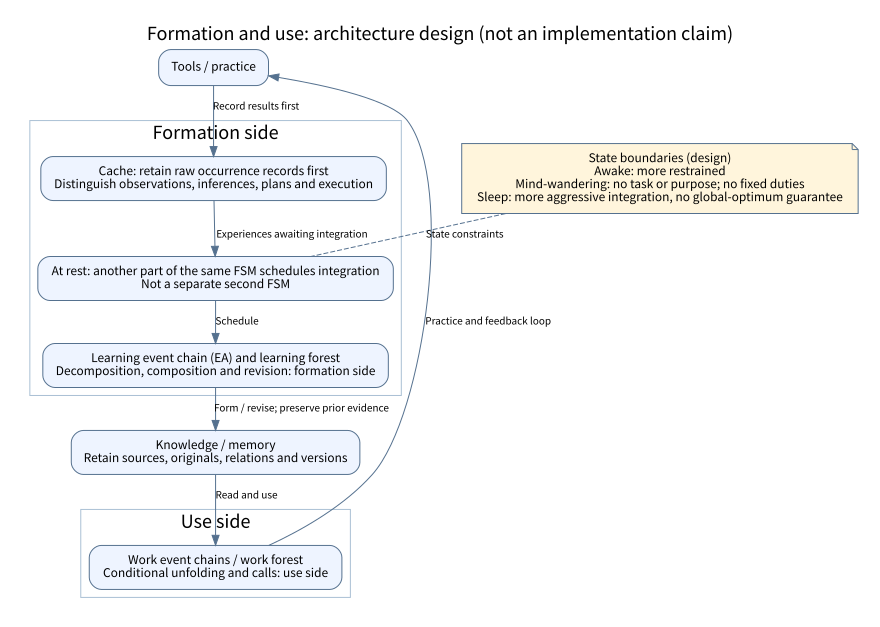
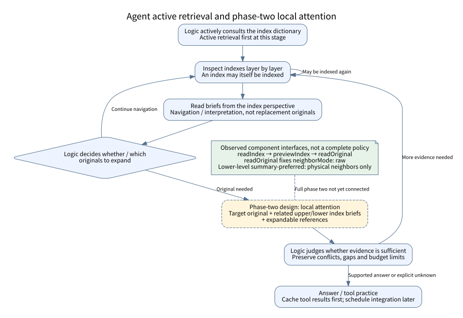
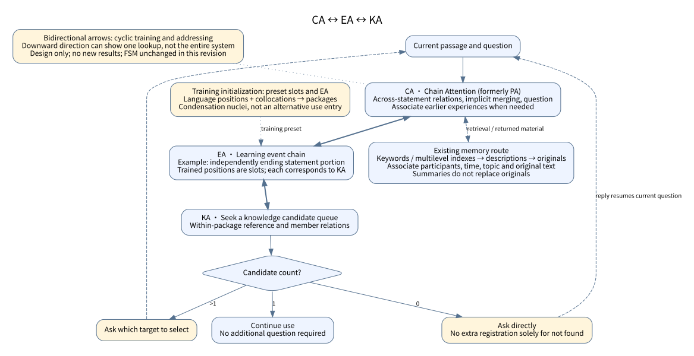

# Architecture flows: formation, use and active retrieval

**2026-11-09 FSM clarification (U-FSM-1109):** [Confirmed responsibilities, resource protection and event-chain continuity](FSM_CONTINUITY.en.md). Memory/past, logic/present, FSM/future remain the classification. The FSM executes symbolic conditions, not understanding; low-risk exceptions are reported, high-risk ones are cut off before reporting, with memory-preservation reserves retained. Both tracks share the event-chain concept but differ in learning integration. This clarification takes precedence over contrary current wording below; historical evidence and implementation claims are unchanged.

[中文](ARCHITECTURE_FLOWS.md) · [Glossary](GLOSSARY.en.md) · [Logic, memory and FSM principles](MEMORY_LOGIC_FSM_PRINCIPLES.md)

Updated: 2026-11-09. Sources: U-1109, U-1107 and C58 (see the [source register](GLOSSARY_SOURCES.json)) and the public designs below. These are public comparison views of the current discussion, not a newly frozen specification or experimental result. This update does not claim a review of every diagram on the earlier site. Frozen plans, historical scores and failure records remain unchanged.

## 1. Forming experience-based knowledge and using it in work



[Editable DOT source](diagrams/formation-use.en.dot)

Arrows describe design responsibilities and feedback directions, not completed operators, interfaces or scheduling algorithms. Learning and work are the **formation and use sides**, without requiring mutually exclusive databases or two separate FSMs.

- Tool-practice results enter the cache first, preserving raw occurrence records and source types. Recording a guess, plan or error does not turn it into a verified fact.
- At rest, **another part of the same FSM** schedules integration of cached experiences. Learning event chains (EA) / the learning forest form or revise knowledge and memory; work event chains / the work forest use existing knowledge, unfold it and call tools. The loop does not require completed learning immediately after every tool call.
- Awake activity is more restrained. Mind-wandering has no task or purpose and is not assigned fixed background duties. Sleep can support more aggressive integration, without guaranteeing local or global optimality. The state annotation is not a complete transition table.
- Raw records, interpretations formed through learning and knowledge versions remain distinguishable. Briefs or relation representations cannot replace memory originals; revisions preserve earlier evidence.

This overview confirms EA as the learning event chain without inventing expansions for KA or EA. The subsequently confirmed CA name (formerly PA) and CA ↔ EA ↔ KA cyclic training and addressing appear separately in diagram 3, without rewriting the meaning of historical diagram 01. Integration operators, scheduling triggers, admission criteria, resource allocation, retention and recovery protocols remain to be specified. No new R algorithm is introduced. If R is added later, its feedback into knowledge, chains, memory admission and the FSM must be made explicit rather than drawing a score box with no defined effect.

## 2. Agent: active retrieval first and phase-two local attention



[Editable DOT source](diagrams/active-retrieval.en.dot)

**Active retrieval is the current priority.** This replaces the earlier passive-first staging, without permanently abandoning passive retrieval. Logic actively consults the index dictionary and selects entry points layer by layer; indexes may themselves be indexed. Briefs introduce material from the corresponding index perspective. Logic decides whether to expand originals, which ones to read and whether the evidence is sufficient.

The **phase-two design** provides the target original, related upper/lower index briefs and expandable references together. Index relationships can involve hierarchy and association; they are not merely physical preceding/following paragraphs. Missing conditions, unclear references, conflicting material or questionable briefs call for reading the relevant originals. No match and exhausted budgets do not prove absence. Summaries do not replace originals; tool results still enter the cache before integration.

**Observed implementation and gaps:** the public RecallAdapter exposes components including `readIndex`, `previewIndex` and `readOriginal`; `readOriginal` currently fixes `neighborMode: 'raw'`. The lower-level `readParagraphWindow` supports `summary-preferred` for physical neighboring paragraphs only: the target stays original, and neighbors fall back to originals when no brief exists. This is not the full index-relationship policy. The complete phase-two combination, relevance and sufficiency judgments are not yet connected and validated. The dashed yellow box marks phase-two design; the green note marks component capabilities only. Other nodes remain responsibility descriptions, not evidence of end-to-end completion.

<a id="use-addressing"></a>

## 3. CA ↔ EA ↔ KA: bidirectional cycles and addressing



[DOT](diagrams/use-addressing.en.dot)

**Author confirmation on 2026-11-09 (U-1109): the arrows in CA ↔ EA ↔ KA are bidirectional, denoting cyclic training as well as addressing.** CA → EA → KA can describe one direction from a passage-level question to knowledge candidates; it does not replace the full bidirectional relationship. PA (Page Attention) is the former name of CA (Chain Attention). EA is the learning event chain; no new English expansions are assigned to KA or EA.

Preset slots and EA belong to **training initialization**. Relatively fixed positions in human language help distinguish words that could occupy the same position; fixed surrounding expressions then help form a composite knowledge package. These presets serve as “condensation nuclei” in the knowledge system, not an alternative use-time entry that bypasses CA or a fixed specification of all final knowledge.

In the language example discussed here, the whole passage corresponds to CA; each statement portion that can end independently corresponds to EA; each trained position in EA is a slot, and each slot corresponds to KA. This describes scope and responsibility, not a punctuation-based segmentation algorithm. Inheriting conditions or objects across statements involves an implicit statement merge and belongs to CA. The final question also belongs to CA.

**KA seeks a candidate queue: with no candidates, ask directly without an extra registration solely for “not found”; with one candidate, continue without an additional question; with multiple candidates, ask which target to select.** The zero-candidate rule does not change existing experience-recording requirements, and a single candidate is not experimental proof of open-world correctness.

When necessary, CA brings in another relevant discussion from much earlier through the memory layer. Keywords and multilevel indexes locate material; descriptions provide low-cost orientation and help avoid the wrong record, followed by original text as needed. Participants, time, topic and original text stay associated so similar discussions by different people or at different times are distinguishable. These are association requirements, not a new mandatory field schema. Original memory is retained in full, not compressed into a summary substitute; compressible knowledge relations are treated separately. This retrieval route is already part of the design, not an unspecified new mechanism.

These are the author's architectural definitions, not new validation results. Earlier experiments did not fully implement the whole architecture. Preserve their individual slice coverage, failures and scores; local results neither establish nor invalidate the entire proposal. The previously deferred FSM discussion is now recorded in U-FSM-1109, linked at the top of this page.

This diagram belongs to the empiricist proposal. Hongchenxian black-box index-reading interfaces are not themselves implementations of internal CA/EA/KA.

## 4. Two senses of merging and the scope of complete validation

“Connecting a subchain into a structure” and “integrating cached experiences” are explanatory qualifiers to avoid ambiguity, not two newly coined formal terms:

- **Connecting a subchain into a structure:** connect main chains and subchains through input, result-interpretation and error protocols, preserving calls, feedback and version relationships. Structural connection does not imply that experience has been absorbed as knowledge.
- **Integrating cached experiences:** decompose, organize, relate or revise retained experiences to form knowledge and memory for later use. Raw records are not disposable drafts overwritten by the latest interpretation.

The complete empiricist proposal includes **logic + memory + FSM**, whose interaction requires whole-system validation. Comparisons distinguish **strict traditional (Transformer LLM), improved/broad traditional (its agent framework), compromise (the slice with this project's memory and FSM), and the complete empiricist form**. Identify concrete implementations and coverage in each approach rather than treating traditional agents and this project's slice as the same proposal. Agents borrow capabilities of their underlying models, so slice success does not establish the complete architecture.

State the models, materials, visible information, budgets, versions and task differences. Compare accuracy, reliability, resistance to contamination, speed and honest preservation of unknowns separately rather than hiding trade-offs in one score. Offline doubles, synthetic identities, correct storage and source checks support only their tested scope. They do not establish complete learning, original-identity recovery, real multi-member collaboration or long-term continuous operation. This update adds documentation and diagrams, not new learning experiments.

## 5. Public sources and reproduction

- [The Abyss design](../projects/the-abyss/DESIGN.en.md): dual forests, knowledge composition, feedback and resource boundaries.
- [Hongchenxian architecture](../projects/hongchenxian/docs/ARCHITECTURE.en.md): retrieval interfaces and offline evidence scope.
- [Logic, memory and FSM principles](MEMORY_LOGIC_FSM_PRINCIPLES.md): observed components and source-code links.
- [Glossary](GLOSSARY.en.md): current definitions, evolution and unresolved items. Explicit newer corrections take precedence over conflicting historical wording without deleting it.

The diagrams are generated from Graphviz DOT with Noto Sans CJK SC and use no online assets. Run from the repository root:

```sh
for f in docs/diagrams/*.dot; do
  dot -Tsvg "$f" -o "${f%.dot}.svg"
done
```

For visual checking, use e.g. `dot -Tpng docs/diagrams/formation-use.en.dot -o /tmp/formation-use.en.png`; PNG files need not be committed. Graphviz and font versions can affect layout. These three bilingual diagram pairs are public comparison views, not replacements for unlisted old diagrams or frozen architecture records.
