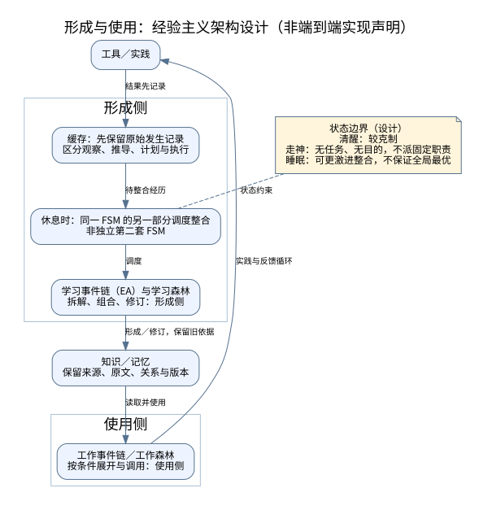
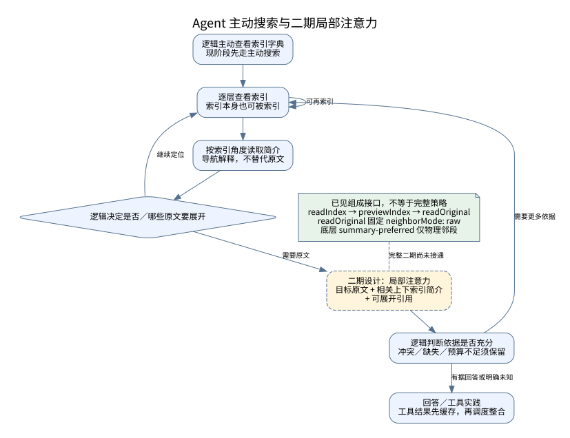
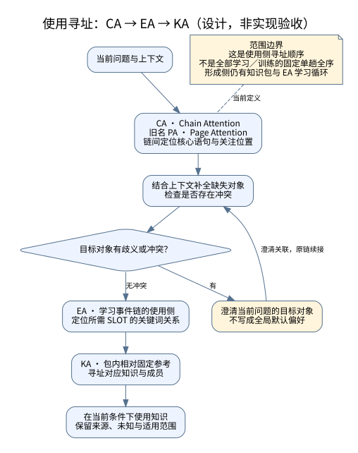

# 架构流程：形成、使用与主动读取

[English](ARCHITECTURE_FLOWS.en.md) · [术语汇编](GLOSSARY.md) · [逻辑、记忆与 FSM 原则](MEMORY_LOGIC_FSM_PRINCIPLES.md)

更新：2026-11-07。来源：U-1107、C58（见[来源清单](GLOSSARY_SOURCES.json)）及下列公开设计。本文是当前讨论的公开对照图，不是新冻结规范或实验成果，不声称已审查旧站全部流程图。新增说明不改写冻结计划、历史成绩或失败记录。

## 1. 经验形成与工作使用



[可编辑 DOT 源文件](diagrams/formation-use.zh.dot)

图中连线表达设计职责与反馈方向，不代表全部算子、接口或调度算法已经实现。学习与工作是**形成／使用两侧**，不要求分成互斥数据库或两个独立 FSM。

- 工具实践的结果先进入缓存，保留原始发生记录及来源性质。记录一个猜测、计划或错误，不把它变成已验证事实。
- 休息时由**同一 FSM 的另一部分**调度缓存经历整合，经学习事件链（EA）／学习森林形成或修订知识记忆；工作事件链／工作森林再使用已有知识、展开并调用工具。循环不表示每次工具调用后必须立即完成学习。
- 清醒时较克制；走神是无任务、无目的的状态，不指定固定后台职责；睡眠可作更激进整合，但不保证局部或全局最优。图中状态注释不构成完整状态转移表。
- 原始记录、学习形成的解释与知识版本应可区分。简介或关系表示不能替代记忆原文；新修订保留旧依据。

本形成／使用总览确认 EA 对应学习事件链，不擅自给 KA／EA 补英文全称。后续确认的 CA（原 PA）命名和 CA → EA → KA 使用寻址单列于图 3，不倒改历史图 01 的含义。具体整合算子、调度触发、准入判据、资源分配、保存期限与恢复协议仍需落实。图中不新增 R 算法；若后续纳入 R，须明确其如何反馈知识、链、记忆准入及 FSM，而不能只画一个没有落实作用的评分框。

## 2. Agent：现阶段主动搜索与二期局部注意力



[可编辑 DOT 源文件](diagrams/active-retrieval.zh.dot)

**当前优先主动搜索。** 这取代此前“先做被动搜索”的阶段安排，不等于永久废除被动搜索。逻辑主动查看索引字典，逐层选择入口；索引可以再被索引。简介从相应索引角度介绍内容，是否展开、展开哪些原文及材料是否足够，都由逻辑判断。

**二期设计**把目标原文、相关上下索引简介和可展开引用一起提供。上下索引关系可涉及层级及关联，不能简化为同一文档的物理前后段。缺条件、指代不明、材料冲突或简介可疑时应展开相应原文；未命中与预算不足不证明材料不存在。原文不被摘要替换，工具结果仍须先缓存再整合。

**已见实现与缺口：** 公开 RecallAdapter 有 `readIndex`、`previewIndex`、`readOriginal` 等组成接口；当前 `readOriginal` 固定 `neighborMode: 'raw'`。底层 `readParagraphWindow` 的 `summary-preferred` 只针对物理邻段，目标段保持原文，邻段无简介时回到原文。它不是完整上下索引关系策略。完整二期的自动组合、相关性与充分性判断尚未接通并验证。图的黄色虚线框表示二期设计，绿色注释仅表示已有组成能力；其他节点仍是职责描述，不保证端到端完成。

<a id="use-addressing"></a>

## 3. 使用寻址：CA → EA → KA



[可编辑 DOT 源文件](diagrams/use-addressing.zh.dot)

**作者已正式确认：PA（Page Attention）更名为 CA（Chain Attention），PA 为旧名；使用寻址按 CA → EA → KA。** 本次更名确认取代此前“PA／CA 关系待确认”的状态，历史文件和冻结代码保留原样，不把旧名批量替换成新实验结论。〔U-CA-1107；F50，见[来源清单](GLOSSARY_SOURCES.json)〕

- **CA：** 链间定位问题核心在哪句话及应关注的位置，联系上下文补全缺失对象并检查冲突；不是跳过中间步骤直接判断知识范围。
- **EA：** 使用学习事件链已有的链内关系，定位所需 SLOT 的关键词；“EA 就是学习事件链”的命名不变，形成过程与使用过程仍要分开描述。
- **KA：** 以包内固定参考组织的成员关系寻址对应知识。图示不补造 KA／EA 的英文全称或统一公式。
- **需要澄清时：** 只把澄清关联到当前问题并续接原链，不把一次对象选择变成全局默认偏好。具体协议、资源与异常路径仍需工程验证。

**使用顺序不是学习总顺序。** 形成侧仍包括知识包学习循环与学习事件链 EA 学习循环，允许来回适配与后续修订。CA → EA → KA 不能泛化成所有训练固定的单趟全序，也不证明现有 v18.1／v19 或其他命名相同模块已完整执行本图。反馈附件中的实现对齐声明本次没有独立核验。

此图属于经验主义方案。红尘仙的主动 dictionary／简介／原文读取流程不能被机械映射为 CA／EA／KA 内部模块；借用黑盒逻辑不代表已经实现这一内部架构。图 1 仍表示形成与使用的大范围循环，这张图补充其中的使用寻址，不倒改旧图的历史含义。

## 4. 两种“合并”与完整验证范围

“子链接入结构”和“缓存经历整合”是为消除歧义加的解释限定，不另造两套正式术语：

- **子链接入结构：** 主子链按输入、结果解释和报错协议接入，保留调用、反馈及版本关联；结构接入不等于经历已经被吸收成知识。
- **缓存经历整合：** 对已保存经历进行拆解、组织、关联或修订，形成可供以后使用的知识记忆；原始记录不是被新解释覆盖的临时草稿。

完整经验主义方案包含**逻辑＋记忆＋FSM**，应整体检查三者如何配合。比较至少分清三方：**传统派（传统 Transformer 与传统 Agent）、妥协派（作者的 Agent 切片）、经验派（逻辑＋记忆库＋FSM 的完整形态）**。每一方均须标明具体实现与覆盖范围，不能把传统 Agent 与本项目切片当作同一方案。Agent 借用底层模型已有能力，切片有效不等于完整架构已成立。

比较应说明模型、材料、可见信息、预算、版本和任务差异，分别看准确性、可靠性、污染抵抗、速度及诚实保留未知，不用一个总分抹掉取舍。离线 double、合成身份测试、存储正确与来源核验只支持各自检查范围，不证明完整学习、原身份恢复、真实多成员协作或长期连续运行。本次仅更新说明和图，没有执行新学习实验。

## 5. 公开依据与复现

- [深渊设计](../projects/the-abyss/DESIGN.md)：双森林、知识组合、反馈与资源边界。
- [红尘仙架构](../projects/hongchenxian/docs/ARCHITECTURE.md)：读取链及离线证据范围。
- [逻辑、记忆与 FSM 原则](MEMORY_LOGIC_FSM_PRINCIPLES.md#五-公开实现支持到哪里)：组成接口和代码链接。
- [词典](GLOSSARY.md)：当前定义、演变和未定项；如历史表述有冲突，以明确标注的新修正为准，不删除历史。

图由 Graphviz DOT 生成，字体使用 Noto Sans CJK SC；不依赖在线资源。从仓库根目录运行：

```sh
for f in docs/diagrams/*.dot; do
  dot -Tsvg "$f" -o "${f%.dot}.svg"
done
```

视觉核验可另用 `dot -Tpng docs/diagrams/formation-use.zh.dot -o /tmp/formation-use.zh.png`；PNG 不需提交。不同 Graphviz／字体版本可能有排版差异。此处三组双语图为公开对照视图，不替代未列出的旧图或冻结架构记录。
