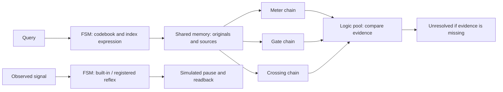

# Hongchenxian: a four-stage Agent demo / 红尘仙四阶段演示

**Extensions and theory:** [DLC 01–03 (English)](DLC.en.md) · [前三个 DLC（中文）](DLC.zh.md) · Stage 5 / DLC 04 theory [English](STAGE5.en.md) · [中文](STAGE5.zh.md)

**Run it in under a minute.** Python 3.10 or newer. No dependencies to install, API key, model, game, or network connection needed after checkout.

```text
git clone https://github.com/zhangyinghao977-beep/ai-memory-agent-framework.git
cd ai-memory-agent-framework/projects/hongchenxian/demo
python demo.py
python -m unittest -v
```

Use `python demo.py --json` for the query expression, matched originals, pause receipts and event-chain cursors. On Windows, `py -3` also works in place of `python`.

The demo follows a fictional gate-watch shift. The meter and the last sighting of a marker are documented; nobody saw the crossing. The program keeps that question open even when the other chains move forward.

| Stage | What you can reproduce |
| --- | --- |
| 1. Memory | Three records share the index `shift`. They retain distinct IDs, original text and sources. |
| 2. FSM retrieval | `+shift \|battery !review` resolves `battery` to `charge`, intersects required terms, unions alternatives and excludes tagged reviews. No LLM is in the retrieval path. |
| 3. Reflexes | An alarm calls a built-in pause. A scoped low-charge reflex works only after registration against a source record. A dropped request stays unconfirmed; the same event is not retried. |
| 4. Logic pool | Meter, gate and crossing have separate event chains in one SQLite store. The crossing chain is handed off; its lack of evidence survives reopening the database. |



The event chain carries **local attention**: what this member is following, which observations exist, and how much the member has reviewed. The logic pool divides coverage across chains. Progress on the meter does not settle a question about the crossing.

### Evidence boundary

Original synthetic input text and an in-process simulated clock only. Multiple owners are represented by a deterministic fixture, not autonomous models or actual parallel workers. The small grammar accepts space-separated terms with `+`, `|`, and `!`; it does not parse unrestricted language or try fuzzy fallback. Reflex registration is explicit, not learned by a model. The demo is public research code, not a benchmark, a production deployment, or an open-source license grant.

## 中文

这是**独立个体 Agent** 的四阶段公开原型，和人工智能本体或商业 Agent 的完整架构分开。只借用一个虚构的门岗场景，不需要任何本地录像、原项目运行环境或私有数据。用上面的命令运行即可。

1. **记忆库**：索引是挂在原文上的关键词列表。共享索引可以缩小范围，不能把几份原文合成一件事。
2. **FSM 与密码本**：将有限查询语法和已登记别名译成集合条件，再按原文 ID 回读，不调用 LLM。
3. **非条件反射与条件反射**：默认保护直接触发；新的防御动作由逻辑显式登记，限定其信号、范围和出处。发出暂停与确认暂停分别登记。
4. **逻辑池与事件链**：事件链承载局部注意力。多个岗位共享原件，各看各的进度，交班沿原链续写。别的链有进展，不替缺证据的链下结论。

此处验的是机制，逻辑分工由脚本预先安排，时钟是模拟的；不宣称能实机操作、自动学出反射，或自主覆盖整个场景。
